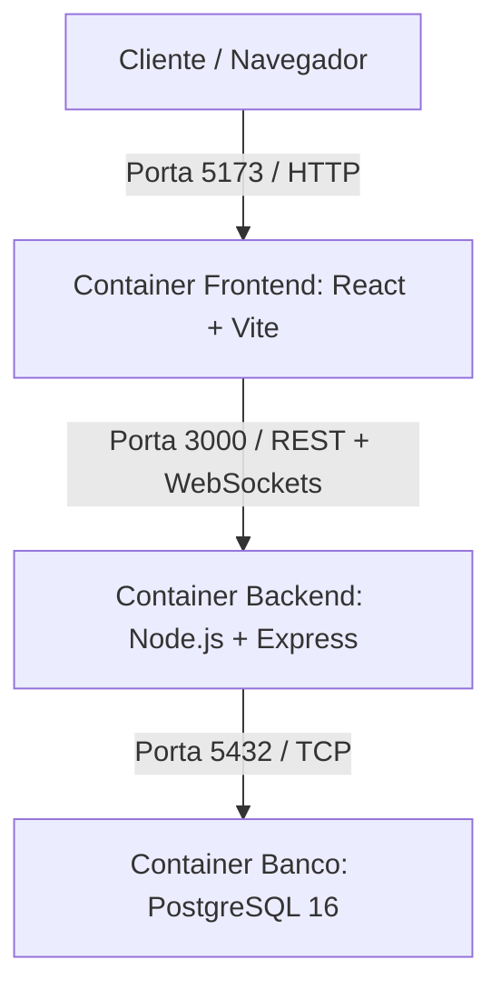

# 📌 Documentação Técnica e Apresentação do Projeto: O Encontrei!

---

## 📄 1. Visão Geral do Projeto

O **O Encontrei!** é uma plataforma web e mobile desenvolvida para revolucionar a gestão de **Achados e Perdidos** em ambientes escolares e acadêmicos. 

O sistema resolve um problema recorrente de perda de pertences (casacos, garrafas, materiais escolares e eletrônicos) integrando alunos, professores e a administração escolar em um ecossistema digital seguro, rápido e inteligente.

### 🎯 Principais Funcionalidades:
* **Cadastro de Itens Perdidos e Encontrados:** Publicação detalhada com fotos, categorias e localização.
* **Busca e Sugestão com Inteligência Artificial:** Cruzamento automático (matching) entre o que foi perdido e o que foi encontrado utilizando modelos de linguagem (IA).
* **Chat em Tempo Real:** Comunicação direta e segura via WebSockets entre quem perdeu e quem encontrou o objeto.
* **Painel Administrativo:** Controle centralizado para a gestão de usuários, moderação de itens e relatórios de devolução.

---

## 📐 2. Arquitetura de Software: Vertical Slice Architecture

Ao contrário da arquitetura tradicional em camadas horizontais (onde controllers, services e repositórios ficam separados em pastas globais genéricas), o **O Encontrei!** foi estruturado utilizando o padrão **Vertical Slice Architecture** (Arquitetura por Fatias Verticais).

```
src/
├── features/           # Cada funcionalidade é um módulo vertical independente
│   ├── autenticacao/    # Login, Registro, Perfil, Termos
│   ├── itens/           # Cadastro, Listagem, Edição de Itens
│   ├── matching/        # Algoritmo de cruzamento por IA
│   ├── chat/            # Mensagens e WebSockets em tempo real
│   └── admin/           # Gestão de usuários e relatórios
```

### 💡 Vantagens da Vertical Slice no Projeto:
1. **Isolamento de Responsabilidade:** Cada funcionalidade (*feature*) contém seu próprio controlador, rotas, regras de negócio e componentes visuais.
2. **Baixo Acoplamento e Alta Coesão:** Alterar o módulo de Chat não afeta o módulo de Autenticação.
3. **Facilidade de Manutenção e Escala:** Permite adicionar novos módulos sem reestruturar o código existente.

---

## 🛠️ 3. Linguagens, Frameworks e Tecnologias Utilizadas

### 🔤 Linguagens de Programação e Formatos:
* **JavaScript (ECMAScript 2024+):** Linguagem principal utilizada em todo o ecossistema **Full-Stack** (tanto no Frontend quanto no Backend).
* **HTML5 Semantic:** Estrutura semântica acessível para a aplicação web.
* **CSS3 (TailwindCSS v4):** Estilização reativa avançada baseada em variáveis e utilitários modernos.
* **JSON:** Formato padrão para troca de dados via API RESTful e configurações de ambiente.

---

### 💻 Frontend (Interface do Usuário):
* **React 19:** Biblioteca principal para criação da interface reativa baseada em componentes reutilizáveis.
* **Vite 6:** Ferramenta de build ultrarrápida e servidor de desenvolvimento frontend.
* **TailwindCSS v4:** Framework de estilização utilitária para design responsivo e moderno.
* **Zustand 5:** Gerenciamento de estado global leve e performático (armazenando dados da sessão do usuário e preferências).
* **React Router DOM 7:** Gerenciamento de rotas e navegação SPA (*Single Page Application*).
* **Lucide React:** Biblioteca de ícones modernos em SVG.
* **Socket.io-Client 4:** Conexão em tempo real para recebimento de notificações e mensagens instantâneas.

---

### ⚙️ Backend (Servidor e API):
* **Node.js:** Ambiente de execução JavaScript assíncrono e orientado a eventos.
* **Express 4:** Framework web para criação de endpoints da API RESTful.
* **Prisma ORM 6:** Mapeamento objeto-relacional para comunicação segura com o banco de dados PostgreSQL.
* **Socket.io 4:** Protocolo WebSockets em tempo real para chat bi-direcional.
* **JWT (JSON Web Token):** Autenticação e autorização segura por tokens stateless.
* **BcryptJS:** Criptografia unidirecional com *salt* para armazenar senhas no banco com segurança.
* **Multer:** Middleware para processamento e upload de imagens enviadas pelos usuários.

---

### 🧠 Inteligência Artificial (IA Integration):
* **OpenRouter API (Meta Llama 3.1):** Integração com modelos LLM para analisar descrições textuais de objetos perdidos e encontrados, determinando a probabilidade de correspondência (*Matching Score*) e sugerindo preenchimento automático.

---

### 🗄️ Banco de Dados:
* **PostgreSQL:** Banco de dados relacional robusto.
* **Neon.tech:** Plataforma de banco de dados PostgreSQL serverless em nuvem com alta disponibilidade.

---

## 🐳 4. Containerização com Docker & Docker Compose

Para garantir que o ambiente de desenvolvimento seja idêntico em qualquer máquina (sem o problema de *"funciona na minha máquina"*), todo o projeto foi containerizado utilizando **Docker**.



### 📦 Estrutura do Docker Compose (`docker-compose.yml`):
* **`banco`:** Container com imagem oficial `postgres:16-alpine`, com volume persistente para dados.
* **`backend`:** Container executando Node.js, realizando a geração automática do Prisma Client e rodando a API na porta `3000`.
* **`frontend`:** Container executando a aplicação web React na porta `5173`.
* **Rede Privada (`encontrei-rede`):** Isolamento de rede permitindo comunicação direta entre os containers.

---

## 🚀 5. Processo de Criação e Hospedagem em Nuvem (DevOps)

### 📈 Linha do Tempo do Desenvolvimento:
1. **Modelagem de Dados:** Criação dos modelos relacionais no Prisma (`Usuario`, `Item`, `Match`, `Mensagem`, `Notificacao`).
2. **Desenvolvimento do Core Backend:** Criação da API RESTful, rotas de autenticação, upload de fotos e controladores.
3. **Desenvolvimento do Frontend:** Criação dos componentes responsivos em React e páginas com suporte mobile (Capacitor).
4. **Integração em Tempo Real:** Implementação de WebSockets com Socket.io para chat de devolução.
5. **Containerização:** Criação de `Dockerfile` e `docker-compose.yml` para execução unificada.
6. **Deploy de Produção (Full-Stack Vercel + Neon Cloud):**
   * **Vercel Serverless Functions:** As rotas do Node.js Express foram convertidas para Serverless Functions em `/api/index.js`.
   * **Vercel CDN:** O build do React Vite é servido em alta velocidade na edge global da Vercel.
   * **Neon PostgreSQL:** Banco de dados relacional em nuvem sincronizado via Prisma db push.

---

## 📌 Resumo da Ficha Técnica

| Item | Especificação |
| :--- | :--- |
| **Nome do Projeto** | O Encontrei! |
| **Paradigma** | Programação Funcional / Reativa + Orientada a Eventos |
| **Arquitetura** | Vertical Slice Architecture + SPA + REST API + WebSockets |
| **Linguagem Principal** | JavaScript (ES6+ Node.js) |
| **Frontend** | React 19, Vite, TailwindCSS v4, Zustand |
| **Backend** | Node.js, Express, Prisma ORM, Socket.io, JWT |
| **Inteligência Artificial** | OpenRouter API (Llama 3.1 LLM) |
| **Banco de Dados** | PostgreSQL (Neon Cloud) |
| **Containerização** | Docker & Docker Compose |
| **Hospedagem de Produção** | Vercel (Frontend & Serverless API) |

